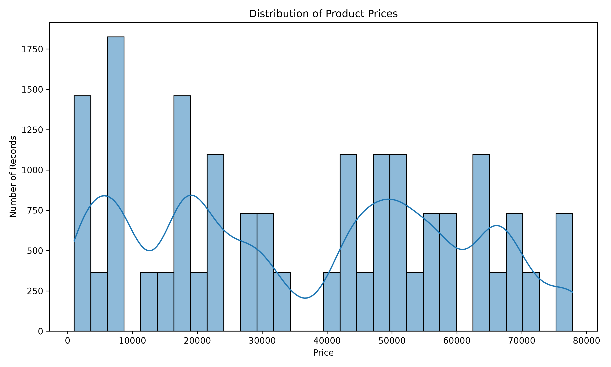
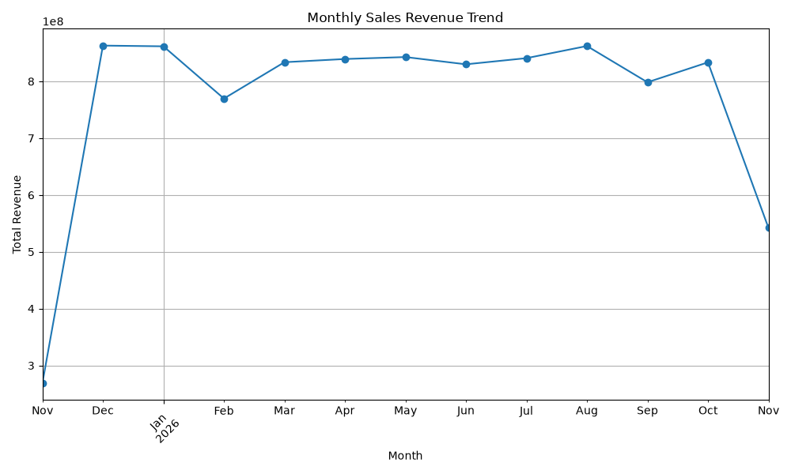
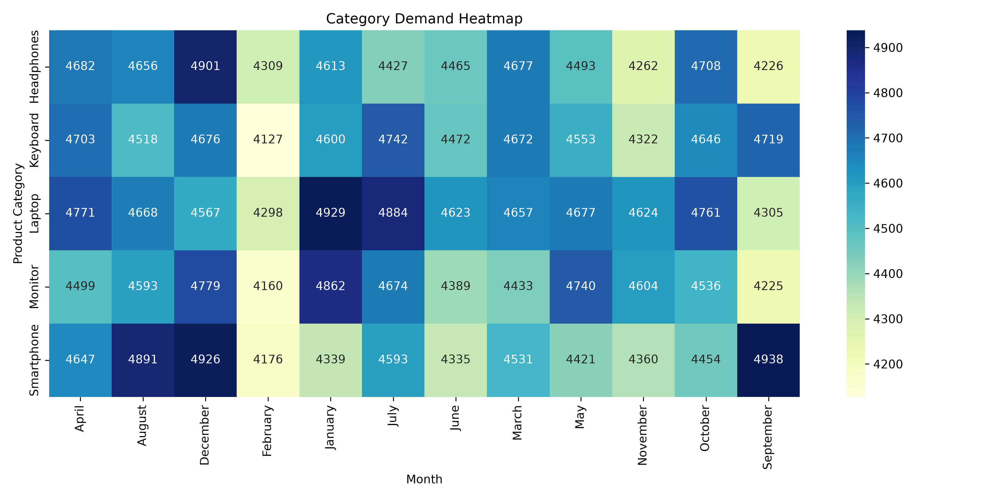

# VoltMart Sales Data – Exploratory Data Analysis

## Overview
This project focuses on Exploratory Data Analysis (EDA) of the VoltMart sales dataset using Python. It explores sales patterns, product pricing, demand across categories, and monthly sales trends through data analysis and visualizations.

## Technologies Used
- Python
- Pandas
- Matplotlib
- Seaborn
- Jupyter Notebook
- Pytest

## Dataset
The project uses `sales_data.csv`, containing 18,250 records representing 50 products across 365 days.

The dataset includes:
- Product ID
- Category
- Price
- Units Sold
- Date

## Exploratory Data Analysis
The EDA is performed in `eda.ipynb`. The notebook:
- Loads and examines the sales dataset.
- Displays dataset structure and summary statistics.
- Checks data types and missing values.
- Examines price distributions and sales demand.
- Identifies patterns through visualizations.

## Data Quality
The dataset contains no missing values. Since the generated CSV had no missing records, no missing-value cleaning was necessary.

## Visualizations

### 1. Price Distribution
Shows the distribution of product prices.



### 2. Monthly Sales Trend
Displays changes in sales activity across the months.



### 3. Category Demand Heatmap
Visualizes product demand across different categories.



## Project Files

- `eda.ipynb` – Main exploratory data analysis notebook.
- `sales_data.csv` – Sales dataset.
- `EDA_report.md` – Summary of EDA findings.
- `price_distribution.png` – Price distribution visualization.
- `monthly_sales_trend.png` – Monthly sales trend visualization.
- `category_demand_heatmap.png` – Category demand heatmap.
- `data_generation.py` – Script used to generate the dataset.
- `test_data.py` – Automated tests for dataset validation and notebook execution.
- `requirements.txt` – Required Python packages.

## Testing

Automated tests are performed using Pytest.

Run the tests using:

```bash
python -m pytest test_data.py -v
```

The test suite contains 8 tests covering dataset validation, column structure, data types, and notebook execution.

## Conclusion
This project demonstrates how Python can be used to explore and understand sales data through statistical analysis and visualizations. The notebook, report, and automated tests make the analysis easier to understand, reproduce, and verify.