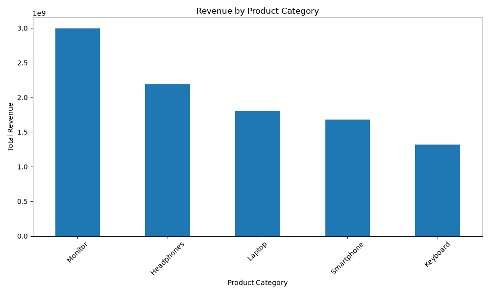

# Sales Data Analysis Project

## Overview
This project performs sales data analysis using Python. It analyzes product sales, calculates revenue, identifies the best-selling and lowest-selling categories, and visualizes sales performance through charts.

## Technologies Used
- Python
- Pandas
- Matplotlib

## Dataset
The project uses a sales dataset (`sales_data.csv`) containing:
- Date
- Product Category
- Product Price
- Units Sold

## Features
- Calculates total sales records.
- Calculates total units sold.
- Calculates total revenue.
- Calculates average product price.
- Analyzes revenue by product category.
- Identifies the best-selling category.
- Identifies the lowest-selling category.
- Generates a revenue bar chart.
- Generates a monthly sales trend line chart.

## Visualizations

### 1. Revenue by Product Category
A bar chart comparing total revenue across different product categories.



### 2. Monthly Sales Revenue Trend
A line chart showing monthly revenue changes throughout the year.


## Project Structure

```text
Ezitech_Data_Science/
│
├── sales_data.csv
├── data_analysis.py
├── revenue_chart.png
├── monthly_sales_trend.png
└── README.md
```

## How to Run

1. Install Python.
2. Install the required libraries:

```bash
pip install pandas matplotlib
```

3. Run the program:

```bash
python data_analysis.py
```

## Conclusion
This project demonstrates the use of Python for basic sales data analysis and visualization. It helps identify sales patterns, compare product categories, and understand monthly revenue trends.
